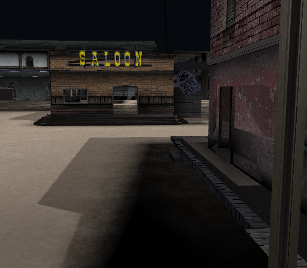
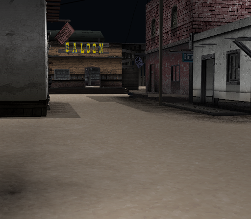

# A shared static projection from passive observations

Date: 4 November 2026. The earlier manually fitted camera is retained as historical
evidence. An observation-derived **inspection** pose now predicts static geometry
across several depths. This is not implemented game camera behavior.

## Observation method and provenance

The unmodified local native backend already reports GS triangle positions and
S/T/Q texture coordinates. No original game instructions, translated functions,
game shaders or decompilation were consulted. Draw labels say frame 4502; the newly
rendered saved image is labeled 4503. Its pixels match an untraced control exactly.
This is a third-party backend reference, not a console or PCSX2 capture.
Raw logs, opaque program labels, matrices, vertex/UV data and texture dumps stay
private. These ordinary observations are not REA retained Evidence or proof of a
formally separated clean room.

The source side uses documented bounded r100 data and unchanged SCR placement.
23,128 nondegenerate source triangles participate, out of 23,288 emitted triangles
after the same manual collection 27/28 exclusions. Compare raw source UVs with
observed S/Q and T/Q using tolerances for printed decimal precision. Test all
corner permutations, reject ambiguous source positions and deduplicate coincident
triangles. UV collisions remain possible; uniqueness is not texture identity.

An attempted texture-dump identity check **failed**: the mirror palette was zero
and its index pattern did not identify a source texture. That output is neither
published nor used as binding evidence.

## A common fit and whole-resource holdouts

4,168 uniquely located UV-candidate triangles span 86 resources. Deduplication of
world/screen rows leaves 3,895 candidate points. Fit one robust projective matrix
to 3,030 training points, withholding 865 points from 18 **whole resources**,
including the saloon-sign resource. Do not fit cameras or transforms per object.

| Geometric observation check | Result |
| --- | --- |
| Training candidates within one pixel | 2,996 / 3,030 |
| Held-out candidates within one pixel | 862 / 865 |
| Held-out median residual | 0.024 pixels |
| Held-out 95th-percentile residual | 0.038 pixels |

These are residuals to passive GS coordinates, **not image-fidelity scores**.
37 candidate outliers remain explicit. Robust selection and shared source/matching
assumptions limit this evidence. Private synthetic solver controls use only original
points: exact known projection, 20% outliers, withheld depths and singular rejection.

All 86 matched resources have **unit scales and zero rotations**. This supports
local geometry/translation in this snapshot, not general Euler order, nonuniform
scales, hierarchy, animation or other rooms. Omitted/re-scaled translations failed
to produce stable full-rank consensus in this bounded solver; that is not proof
that no alternative camera can exist.

## Projection aspect and the failed first render

The inferred pose suggests approximately 31 degrees vertical FOV and a **4:3
projection on a 512x448 framebuffer**. Projection aspect is not framebuffer aspect.
This does not establish a universal PS2 display pixel aspect or video mode.
The earlier manual camera was wrong; matching one saloon facade was insufficient.

The first two actual captures at this pose were completely blocked by the rear of
a close surface because the inspector was two-sided. Keep those failed originals
locally. Matched emitted triangles mostly have conventional front-facing source
winding: 4,107 negative versus 34 positive signed screen areas. Explicit back-face
culling exposes the street **without removing another collection or moving any
geometry**. It is diagnostic: mixed sidedness and per-material rules are not solved.

The updated [camera contract](../specs/inspection-camera-v1.md) exposes
`--camera-aspect` and `--backface-culling`. The adapter preserves explicit aspect
through Bevy resizing while delegating standard matrices/frusta to pinned Bevy
interfaces. Defaults remain automatic aspect and two-sided inspection.

```text
--layout st1/r100.dat --exclude-collection 27 --exclude-collection 28
--camera-eye -4.4560604,1.3398599,35.0116218
--camera-target -2.3145737,0.6408461,25.2686544
--camera-fov 31 --camera-aspect 1.3333333333 --view-size 512,448
--backface-culling --static-colors --smoke-seconds 10
--capture-png <new private PNG path>
```

This centered Y-up approximation of the full fitted matrix gives 0.077 pixel
median and 0.103 pixel 95th-percentile geometric residual on accepted candidates,
across inferred depths roughly 2.4..123.4 diagnostic units. This is not a measure
of Bevy image quality or proof of the game's unit convention.

## Actual unchanged images

The [new Reference / Bevy comparison](https://yyoudi.github.io/god-hand-rs/dashboard/#comparison-2026-11-04-observed-projection)
publishes the unchanged frame-4503 PPM, labeled lossless PNG preview and Bevy PNG.
The near left facade, distant saloon and right storefront now share one camera.
No crop, warp, repainting or generated substitute was used.

| Before: previous manual pose, source colors | After: observation-derived inspection |
| --- | --- |
| [](dashboard/media/a66e16783e72e42734cc0e0290f1fe09b3f6bdf83fc004abd9e302c6c8c5736d.png) | [](dashboard/media/981495f27c6ca827cb235386310fba305b8d5101ca5aea669eaf70443102fd92.png) |

The after view changes pose/projection and explicit culling, not object placement
or pixels after capture. Sky, actors, HUD, some props and full light/fog/alpha/
filter/pass semantics remain missing or wrong. Source colors stay experimental.

## Actual validation and next experiment

57 base Rust tests plus 3 additional viewer-only tests (60 distinct tests),
25 Python tests, fmt, locked check/build and five pre-ISO CLI rejection cases pass.
Matrix/resize tests compare Bevy's adapter to the CPU oracle without opening a GPU.
Real default/color and culled default/color smokes exit at ten seconds. The new
PowerShell workflow replay is byte-identical to its first capture. A new old-pose/
default run is byte-identical to the earlier original. No game data enters tests
or CI. Public CI also runs viewer-only synthetic adapter tests on a standard runner.

Next validate a second retail viewpoint with independent whole-resource holdouts.
Keep camera motion, general SCR transforms, resource activation and full rendering
as separate unresolved gates. The prototype remains a separate reference.
