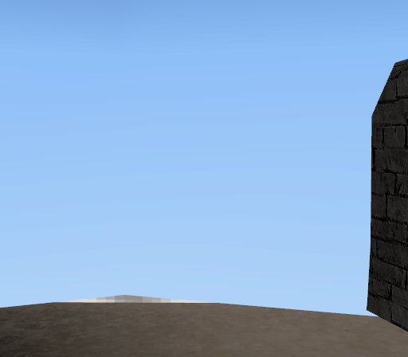
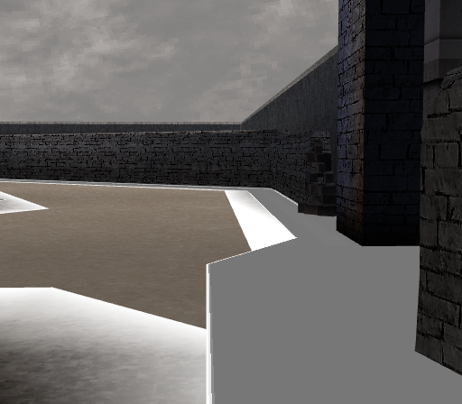

# Separate alpha and depth: first autonomous-goal increment

Date: 5 November 2026. Starting revision: 5d35247. The new autonomous goal targets
native Rust/Bevy rendering, beginning with the full-resource sky-overpainting
failure. [Execution workflow](native-rendering-workflow.md).
The goal remains active; this first CPU model is not completion of GPU rendering.

## A rejected all-opaque control

The public inspector currently uses AlphaMode::Blend for both material paths.
Pinned Bevy0.20.1's alpha-blend mesh pipeline disables depth writes; its opaque
pipeline enables them. This was checked in the installed, exact dependency source.

Privately copy our own app sources at the baseline and change only those two
AlphaMode::Blend choices to Opaque. Keep the shader, ISO, geometry, cameras,
source colors and culling unchanged; include **all156 nodes**, with no collection
exclusions. Both established views render and exit at their ten-second deadlines.
The standalone probe uses the same registry versions/checksums as Cargo.lock.

Geometry reappears, but shadow regions become black blocks, cutouts lose their
holes and the sky is wrong. Reject this as a shipping policy. Changing alpha mode
also changes blending and queue membership: it does **not isolate depth writes
alone**, or establish which sky resources are active. No production visual change
was shipped by this increment.

The unmodified RGBA control capture also retains fractional/zero alpha. In a
browser, composition against the page can show pale/white areas where an opaque
window looked dark. This is another control artifact, not corrected image data.
Future work must distinguish stored framebuffer alpha from presentation alpha;
never flatten old originals and relabel them as unchanged captures.

The journal preserves the failed all-blend baseline and all-opaque diagnostic,
with the same original retail reference. They are unretouched original renders,
not generated pictures or edited improvements. The probe is honestly labeled a
private uncommitted control, not the public engine revision. Its own-source delta
is exactly the two alpha-mode substitutions above; receipts remain local.

## Before / after the control, not an improvement claim

Both originals use the same camera and complete resource selection. The after
image is a rejected private experiment, not the new public viewer behavior.

| Before: f83f076, all-blend | After: private uncommitted all-opaque control |
| --- | --- |
|  |  |

## Observe permissions, not just source opacity

Join existing UV-candidate triangles to existing passive draw observations,
retaining only geometry consistent with the common projection within one pixel.
176 candidate buffers in the first view and28 in the second show enabled alpha
blending, unmasked depth writes and alpha testing together. Per-view counts are
not disjoint coverage or texture-identity proof. Failure actions differ: some
prevent writes, others permit framebuffer-only updates. A simple source-opacity
scan cannot establish every per-asset action.

The observed threshold is greater than127. Independent primary hardware research
[ps2tek](https://psi-rockin.github.io/ps2tek/) documents the alpha-stage comparison
and separate failure-update choices. These observations motivate modeling distinct
RGB/framebuffer-alpha/depth permissions instead of one opaque/transparent Boolean.
Raw traces, program labels, game vertex data and per-buffer mappings stay private.
No game instructions, translated functions, original shaders or decompilation
were implementation input; this is not a formal clean-room certification.

## First original implementation

[fragment_alpha.rs](../crates/engine/src/fragment_alpha.rs) implements the
[contract](../specs/fragment-write-permissions-v1.md): unsigned byte comparisons,
all four alpha-failure actions, disabled/passing tests and depth-write-mask
precedence. Permissions are not final fragment updates: other tests, component
masks, blend arithmetic and draw ordering are separate. This code does not infer
which runtime state belongs to a game asset and is **not wired to Bevy yet**.

Synthetic tests exhaust alpha/reference pairs against an independent three-way
truth table, test partition counts and all failure actions, and exercise the
127/128 boundary. No game data or image pixels are fixtures. Current validation:
61 base Rust tests plus3 additional viewer-only tests (64 distinct),25 Python
tests, formatting and locked viewer check pass. The private actual-ISO controls
are real GPU observations, not synthetic GPU conformance tests.

## Next falsifiable step

Specify GPU write/discard behavior with original overlapping geometry: passing
fragments, framebuffer-only failures, Keep failures, holes, depth equality and
submission permutations. Investigate byte-domain GS blending versus host linear
blending and texture-alpha normalization explicitly; do not hide these differences
behind a higher-level material flag. Then compare both unchanged full-resource
retail views, retain regressions and publish evidence-supported changes.

Sky activation, general transform semantics, actors/HUD, gameplay and complete
rendering remain unresolved. The prototype is separate, raw game artifacts stay
private, and publication uses standard public CI and free main:/docs GitHub Pages.

## Subsequent component validation

The [ordered GPU increment](ordered-alpha-gpu-2026-11-05.md) now consumes this
CPU model in a synthetic offscreen renderer. This supersedes the earlier
not-wired statement for that component only; production retail integration,
blending and the two-view full-resource acceptance gate are still pending.
