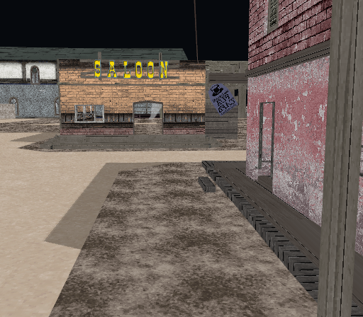
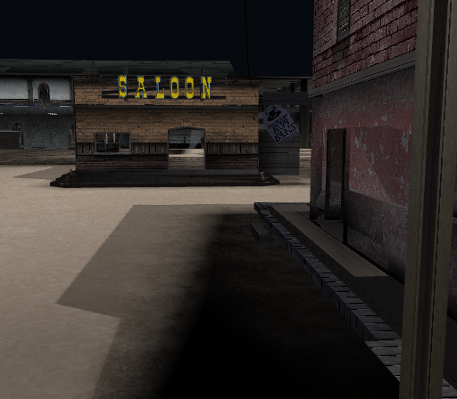

# Source colors and observed render state

Date: 4 November 2026. Raw MDB source colors are now preserved. An opt-in
inspection shader consumes them, with the previous camera held fixed. This is
**not complete game lighting or GS state replay**; the default view is unchanged.

## First rule out a wrong asset candidate

A read-only data-fingerprint scan compared sampled room-data bytes with the
existing first-fight runtime snapshot. No instructions were decoded or exposed
as implementation input. Sixteen sampled r100 fingerprints had the same contiguous
copy origin. A full comparison then showed an important distinction:

- The **entire DAT is not identical**: 2,216 bytes differ in opaque non-SCP areas.
- Its complete **1,187,648-byte SCP geometry/texture storage span is identical**
  to the ISO. Private checksums and a full byte comparison corroborate this.

This establishes asset-data presence in the snapshot, not that every resource
is active, drawn, or placed correctly. Other partial matches are not treated as
scene identities. Snapshot contents, positions, raw extracts and fingerprints
remain private; no CPU/game-code implementation was derived from the scan.

## Observe the actual draw state

The unmodified native backend already provides a passive GS draw observer. A
controlled resume captured 911 draw groups at frame 4502, including modulation,
decal/highlight variants, fog, alpha tests/blends, filtering/mips and multiple
targets/passes. A traced/control pair of the newly rendered frame 4503 is
byte-identical. The observer did not need a backend patch or game-code analysis.

The public comparison still uses the earlier original frame 4501. These nearby
draw observations are **not** an exact draw-to-asset map for that image. Opaque
VU program labels in the private trace were not decoded or used, and are not
published. This project does not claim a formally separated clean room.

## Reader and color experiment

All 1,155 mesh buffers in the three measured candidates contain a four-byte
source-color stream, with observed channel values 0..128 and variable alpha.
The bounded Rust reader preserves raw bytes and keeps absence explicit. It
does not normalize source data or invent white in the disc layer.

The original [contract](../specs/static-colors-v1.md), Rust arithmetic oracle and
embedded WESL shader implement a deliberately limited experiment: byte-domain
RGB modulation with neutral 128, screen-linear source-color interpolation,
truncation/clamping and the appropriate output transfer for Bevy's sRGB target.
Hardware arithmetic is informed by independent [ps2tek research](https://psi-rockin.github.io/ps2tek/).
No game shader, translated function or third-party implementation was copied.

Source colors are not necessarily the final lit colors sent to the GS. The
experiment does not recover dynamic light calculations, fog, texture-function
selection, filtering, alpha tests/blends or postprocessing. Alpha uses diagnostic
host blending on the texture reader's normalized opacity; it is not the complete
original alpha pipeline. Two-sided rendering and explicit 27/28 exclusions remain.

## Before / after, same camera

These are unchanged original Bevy screenshots; clicking opens the full file.
No camera, geometry, crop, warp or image retouching was used to improve alignment.

| Before: default texture-only view | After: `--static-colors` experiment |
| --- | --- |
|  |  |

The [reference / color-mode pair](https://yyoudi.github.io/god-hand-rs/dashboard/#comparison-2026-11-04-source-colors)
retains the unchanged original reference PPM and its labeled lossless PNG preview.
The previous plain and overhead iterations also remain available.

Facades darken and ground alpha/shading changes. Some shadow regions become
**excessively dark**. This is a discrepancy to investigate, not a fidelity pass
or an improvement percentage. The camera is still manually fitted to one facade;
other-depth parallax and general SCR/runtime semantics remain unverified.

Enable explicitly with `--static-colors` in mesh/layout inspection, or Layout
`-StaticColors` in scripts/dev.ps1. It remains disabled by default.

## Actual validation

- 56 synthetic Rust and 25 Python tests pass; formatting and Bevy check/build pass.
- A private no-disc GPU harness uses the public shader/viewer and the exact
  registry versions/checksums in Cargo.lock. Four uniform swatch samples and three
  depth-varying triangle samples match CPU expectations exactly on this setup.
  This checks component arithmetic/interpolation, not game-image fidelity.
- Synthetic GPU probes and real scene smokes exit at their ten-second deadlines.
  The scripted color-mode replay is byte-identical to its first capture. A new
  default/off run is byte-identical to the previous default PNG.
- The updated reader accepts all three room candidates with geometry counts
  unchanged. No game data serves as synthetic fixtures or CI execution input.

Next: relate observed state to individual resources and compare independent
depth-separated landmarks at the fixed camera. Preserve original palette/vertex
semantics and investigate missing light/fog/alpha/filter/pass state rather than
fitting each object independently or hiding regressions with image edits.
